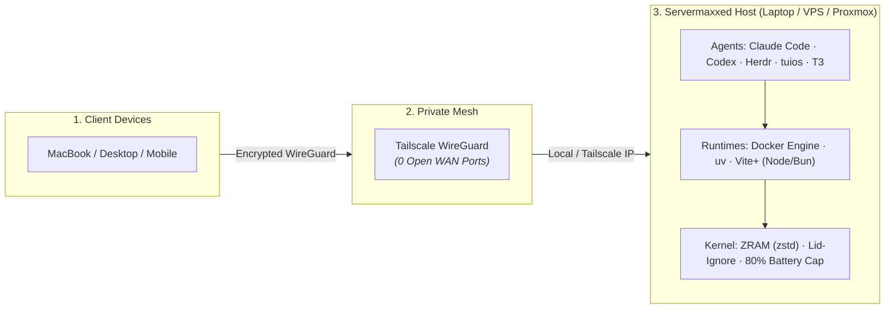

<div align="center">

# ⚡ servermaxxing

### Turn dusty laptops, cheap VPS instances, and homelab boxes into autonomous 24/7 AI agent workstations.

[](LICENSE)
[](#)
[](https://tailscale.com)
[](#-the-stack)
[](#-the-stack)

<br/>

```bash
curl -fsSL https://raw.githubusercontent.com/kshanxs/servermaxxing/main/scripts/servermaxxing.sh -o /tmp/servermaxxing.sh && sudo bash /tmp/servermaxxing.sh
```

**One command. Zero bloat. Fully tuned for autonomous coding agents.**

</div>

---

## 💀 The Problem: Raw Linux is Horrible for AI Agents

When you spin up a fresh VPS, repurpose a spare laptop, or spin an LXC container for autonomous coding agents (Claude Code, Codex, Aider), you hit immediate friction:

| Raw Server Default | What Happens When An Agent Runs | `servermaxxing` Fix |
| :--- | :--- | :--- |
| **Lid Closes / Idles** | Box immediately suspends, killing your agent mid-task. | **Permanent lid & sleep masking** — runs 24/7 with the lid closed. |
| **Heavy Builds (npm/pip/docker)** | 4GB–8GB boxes thrash the SSD swap, freeze, and OOM kill. | **In-memory ZRAM (zstd, 50% RAM)** — doubles effective memory speed. |
| **Laptop Battery on AC** | Lithium battery sits at 100% heat stress until it swells. | **Automated 80% charge threshold** cap to preserve battery health. |
| **Port Forwarding / SSH** | Exposing port 22 or web editors to public WAN gets probed. | **Tailscale Mesh VPN** — zero open public ports, accessible worldwide. |
| **Sudo Password Prompts** | Agent hangs indefinitely waiting for non-interactive sudo. | **Scoped non-interactive sudoers rule** for agent execution. |
| **Tooling Gaps** | Agent lacks fast search tools and wastes tokens doing `find /`. | **`ripgrep`, `fd`, `fzf`, `superfile`, `tuios`, `fastfetch` pre-installed.** |

---

## ⚡ Quick Start: One-Liners

### 1. Instant Servermax (Recommended)
Tuning takes under 60 seconds on Ubuntu 22.04 / 24.04:

```bash
curl -fsSL https://raw.githubusercontent.com/kshanxs/servermaxxing/main/scripts/servermaxxing.sh -o /tmp/servermaxxing.sh && sudo bash /tmp/servermaxxing.sh
```

---

### 2. Auto-Launch & Agent Hand-Off
Tune the server and immediately drop into an active agent session with the `servermaxxing` skill pre-seeded. Pick your agent:

**Anthropic Claude Code:**
```bash
curl -fsSL https://raw.githubusercontent.com/kshanxs/servermaxxing/main/scripts/servermaxxing.sh -o /tmp/servermaxxing.sh && sudo bash /tmp/servermaxxing.sh --agent claude
```

**Codex CLI:**
```bash
curl -fsSL https://raw.githubusercontent.com/kshanxs/servermaxxing/main/scripts/servermaxxing.sh -o /tmp/servermaxxing.sh && sudo bash /tmp/servermaxxing.sh --agent codex
```

**tuios (Tiling Window Manager with Agent Approval Inbox):**
```bash
curl -fsSL https://raw.githubusercontent.com/kshanxs/servermaxxing/main/scripts/servermaxxing.sh -o /tmp/servermaxxing.sh && sudo bash /tmp/servermaxxing.sh --agent tuios
```

**Herdr (Persistent Agent Session Multiplexer):**
```bash
curl -fsSL https://raw.githubusercontent.com/kshanxs/servermaxxing/main/scripts/servermaxxing.sh -o /tmp/servermaxxing.sh && sudo bash /tmp/servermaxxing.sh --agent herdr
```

> [!NOTE]
> The script automatically installs the requested agent CLI, seeds the `servermaxxing` skill into `~/.agents/skills/`, and drops root privileges so your agent runs safely under your standard user.

---

### 3. Headless Cloud VPS (DigitalOcean / Hetzner / Linode)
On a brand new VPS where you are logged in directly as `root`:

```bash
apt-get update -y && apt-get install -y curl
id -u dev &>/dev/null || (adduser --disabled-password --gecos "" dev && usermod -aG sudo dev)
su - dev -c "curl -fsSL https://raw.githubusercontent.com/kshanxs/servermaxxing/main/scripts/servermaxxing.sh -o /tmp/servermaxxing.sh && sudo bash /tmp/servermaxxing.sh"
```

> [!TIP]
> **Zero-Touch Tailscale Mesh + SSH:** Pass your pre-auth key via CLI flag or env var to join your private mesh with Tailscale SSH and non-root operator privileges enabled automatically:
> ```bash
> # Using CLI flag
> curl -fsSL https://raw.githubusercontent.com/kshanxs/servermaxxing/main/scripts/servermaxxing.sh -o /tmp/servermaxxing.sh && sudo bash /tmp/servermaxxing.sh --tailscale-key "tskey-auth-..."
>
> # Or using environment variable:
> curl -fsSL https://raw.githubusercontent.com/kshanxs/servermaxxing/main/scripts/servermaxxing.sh -o /tmp/servermaxxing.sh && sudo TAILSCALE_AUTHKEY="tskey-auth-..." bash /tmp/servermaxxing.sh
> ```
> *Features auto-configured:*
> - **Tailscale SSH (`--ssh`)**: Keyless, encrypted SSH straight from your mesh without opening port 22.
> - **Non-Root Operator (`--operator`)**: Allows the non-root agent user to run `tailscale status`, `tailscale serve`, and `tailscale funnel` without `sudo`.
> - **Kernel Packet Forwarding**: Pre-configures `net.ipv4.ip_forward=1` for subnet routing or exit node use.
> - Pass `--no-tailscale-ssh` if you prefer to manage host SSH independently.

---

## 🛠️ The Stack: What Gets Maxxed

```
┌────────────────────────────────────────────────────────────────────────┐
│                        SERVERMAXXED ENVIRONMENT                        │
├────────────────────────────────┬───────────────────────────────────────┤
│ 🤖 Agent Runtimes & Daemons    │ Claude Code · Codex CLI · T3 Code     │
│ 🪟 Multiplexers & Terminal UI  │ tuios · herdr · tmux · superfile (spf)│
│ ⚡ Modern Language Engines      │ uv & uvx (Python) · Vite+ (Node & Bun)│
│ 🐳 Container Runtime           │ Docker Engine 29.x & Compose v2       │
│ 🔒 Mesh Networking             │ Tailscale WireGuard (Zero Open Ports) │
│ 🚀 System Accelerators         │ ZRAM (zstd swap) · ripgrep · fd · fzf │
│ 🛡️ Hardware Defense (Laptops)  │ Lid-ignore · Sleep-mask · 80% Batt Cap│
└────────────────────────────────┴───────────────────────────────────────┘
```

### Detailed Layer Breakdown

| Layer | Tools | Why It Matters for Agents |
| :--- | :--- | :--- |
| **Hardware & Power** | `logind.conf.d`, `systemd mask`, `charge_control_limit` | **24/7 continuous uptime.** Shuts down display sleep, ignores clamshell closure, and caps battery charging at 80% to stop swollen batteries. |
| **Memory & Storage** | `zram-tools` (`zstd`, 50% RAM) | Agents run resource-hungry builds. ZRAM compresses pages directly in memory, preventing system stalls and NVMe/SSD wear. |
| **Agent Multiplexing** | **`tuios`** & **`herdr`** | Tile multiple running agents, manage approvals in a unified inbox, and reconnect to sessions across devices without dropping state. |
| **Fast Runtimes** | **`uv` / `uvx`** & **`Vite+` (`vp`)** | Instantly executes Python scripts and virtual environments at 10x-100x pip speeds. Fast Node/Bun management without version managers breaking. |
| **CLI Speed Pack** | `ripgrep`, `fd-find`, `fzf`, `superfile`, `btop`, `fastfetch`, `speedtest` | High-efficiency terminal tools. Gives agents sub-millisecond code exploration commands so they don't burn tokens on slow bash pipelines. |
| **Access & Security** | `tailscale`, rootless `docker`, scoped `sudoers` | Connect from your MacBook, phone, or desktop with 0 open firewall ports. Agent executes Docker and system tasks without authentication deadlocks. |

---

## 🏗️ System Architecture



---

## 📚 Deep Dive Guides

Looking to build a homelab cluster or optimize a specific virtualization stack? Check out the full guides:

- 📖 **[Ubuntu Server Setup Guide](docs/setup.md)** — Complete step-by-step walkthrough covering manual setups, Wi-Fi powersave tweaks, and tool configurations.
- 🖥️ **[Proxmox VE Setup Guide](docs/proxmox.md)** — Optimized LXC containers with Docker nesting and Tailscale TUN pass-through, plus GPU passthrough for local models.
- 🌐 **[Multi-Node LAN Deployment](docs/multi-node-deployment.md)** — Decouple heavy agent compute from production database nodes across local gigabit LAN.

---

## 🔒 Security Principles

1. **No Hardcoded Secrets**: All scripts use dynamic `$USER` and `$SUDO_USER` resolution with zero baked-in credentials.
2. **Zero Inbound WAN Ports**: Remote access relies entirely on WireGuard state tunnels via Tailscale.
3. **Least-Privilege Hand-Off**: Auto-launch drops privileges from root to the non-root host user immediately before starting agents.

---

## 📄 License & Author

[MIT](LICENSE) © [kshanxs](https://github.com/kshanxs) (Shubhanshu Shukla)

