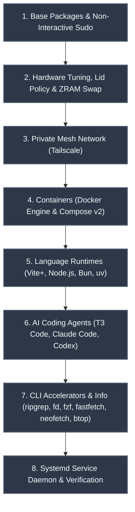

# Ubuntu Server Setup Guide for Dedicated AI Agent & Remote Dev Box

A complete, production-ready guide to configuring a fresh **Ubuntu Server** (or repurposed laptop/desktop) into a dedicated, high-performance remote coding machine equipped with **Tailscale**, **T3 Code Nightly**, **Claude Code**, **Codex**, **Docker**, modern runtimes (**Vite+**, **uv**), and optimized AI-agent tooling.

---

## 1. Quick Start: All-in-One Automated Setup

### A. Direct One-Liner (Standard Sudo User)
If you already have a standard user with `sudo` access, download to a temporary script and run with `sudo` (protects `stdin`, allows full interactive agent hand-off, and prevents partial-download execution):

```bash
curl -fsSL https://raw.githubusercontent.com/kshanxs/servermaxxing/main/scripts/servermaxxing.sh -o /tmp/servermaxxing.sh && sudo bash /tmp/servermaxxing.sh
```

### B. Fresh Cloud VPS / Root Login Sequence
On a freshly provisioned cloud VPS (where you are logged in directly as `root` and `curl` may not be installed):

```bash
# 1. Ensure curl is present and create a dedicated non-root agent user
apt-get update -y && apt-get install -y curl
id -u dev &>/dev/null || (adduser --disabled-password --gecos "" dev && usermod -aG sudo dev)

# 2. Execute servermaxxing as the non-root user
su - dev -c "curl -fsSL https://raw.githubusercontent.com/kshanxs/servermaxxing/main/scripts/servermaxxing.sh -o /tmp/servermaxxing.sh && sudo bash /tmp/servermaxxing.sh"
```

### C. Agent Auto-Launch (Hands-Free Handoff to Claude / Codex)
Pass the `--agent <name>` flag to automatically provision the box and immediately launch an interactive coding agent inside an unprivileged user session with the `servermaxxing` skill pre-loaded:

```bash
# Hands-free handoff to Claude Code:
curl -fsSL https://raw.githubusercontent.com/kshanxs/servermaxxing/main/scripts/servermaxxing.sh -o /tmp/servermaxxing.sh && sudo bash /tmp/servermaxxing.sh --agent claude

# Hands-free handoff to Codex CLI:
curl -fsSL https://raw.githubusercontent.com/kshanxs/servermaxxing/main/scripts/servermaxxing.sh -o /tmp/servermaxxing.sh && sudo bash /tmp/servermaxxing.sh --agent codex
```

> [!TIP]
> **Tailscale Automated Join:** Pass `TAILSCALE_AUTHKEY="tskey-auth-..."` before `bash` to authenticate immediately without waiting for interactive OAuth URLs.

*(Or follow the step-by-step sections below for full visibility and granular control).*


---

## 2. Setup Pipeline Overview



---

## 3. Step-by-Step Setup

### Step 1: Base System Update & Essential Packages
Update package lists, upgrade existing packages, and install foundational build and network utilities:

```bash
sudo apt update && sudo apt upgrade -y
sudo apt install -y --no-install-recommends \
    curl \
    wget \
    git \
    unzip \
    build-essential \
    ca-certificates \
    gnupg \
    lsb-release \
    software-properties-common \
    apt-transport-https
```

#### Non-Interactive Sudo (Recommended for Remote Agent Automation)
Allows local AI coding agents and automated build scripts to perform package installs without hanging on interactive password prompts:

```bash
echo "$USER ALL=(ALL) NOPASSWD:ALL" | sudo tee /etc/sudoers.d/$USER
sudo chmod 0440 /etc/sudoers.d/$USER
```

---

### Step 2: Hardware, Power & Memory Tuning

#### 1. 24/7 Never-Sleep & Battery Longevity Tuning (For Laptop Servers)
If running Ubuntu on a laptop, configure `systemd` to completely prevent suspension, ignore lid closes across AC and battery, keep Wi-Fi awake, and protect the battery against swelling under continuous wall power:

```bash
# 1. Mask systemd sleep & suspend targets completely
sudo systemctl mask sleep.target suspend.target hibernate.target hybrid-sleep.target

# 2. Configure systemd-logind to ignore lid-close across all power states
sudo mkdir -p /etc/systemd/logind.conf.d
cat << 'EOF' | sudo tee /etc/systemd/logind.conf.d/ignore-lid.conf
[Login]
HandleLidSwitch=ignore
HandleLidSwitchExternalPower=ignore
HandleLidSwitchDocked=ignore
LidSwitchIgnoreInhibited=no
EOF
sudo systemctl kill -s HUP systemd-logind 2>/dev/null || true

# 3. Disable Wi-Fi power saving (prevents high latency & SSH/Tailscale drops over Wi-Fi)
sudo mkdir -p /etc/NetworkManager/conf.d
cat << 'EOF' | sudo tee /etc/NetworkManager/conf.d/default-wifi-powersave-on.conf
[connection]
wifi.powersave = 2
EOF
sudo systemctl reload NetworkManager 2>/dev/null || true

# 4. Battery Longevity Health Cap: set 80% charge threshold to avoid battery swelling on 24/7 AC power
for bat_thresh in /sys/class/power_supply/BAT*/charge_control_end_threshold; do
    if [ -w "$bat_thresh" ]; then
        echo 80 | sudo tee "$bat_thresh" > /dev/null || true
    fi
done
```

#### 2. Disable Unnecessary Background Daemons
Free up RAM and CPU cycles by disabling services not needed on a dedicated server:

```bash
# Disable cellular modem daemon (not needed on Wi-Fi/Ethernet)
sudo systemctl stop ModemManager.service 2>/dev/null || true
sudo systemctl disable ModemManager.service 2>/dev/null || true
sudo systemctl mask ModemManager.service 2>/dev/null || true

# Disable SAN multipath daemon (not needed on single NVMe/SSD)
sudo systemctl stop multipathd.service 2>/dev/null || true
sudo systemctl disable multipathd.service 2>/dev/null || true
sudo systemctl mask multipathd.service 2>/dev/null || true

# Disable continuous firmware daemon (run on-demand when updating firmware)
sudo systemctl stop fwupd.service 2>/dev/null || true
sudo systemctl disable fwupd.service 2>/dev/null || true
```

#### 3. Enable In-Memory Compressed Swap (ZRAM)
ZRAM creates an in-memory compressed swap device (zstd). When AI agents or npm builds trigger high memory usage, memory is compressed into RAM rather than thrashing slow disk swap:

```bash
sudo apt install -y zram-tools

cat << 'EOF' | sudo tee /etc/default/zramswap
ALGO=zstd
PERCENT=50
PRIORITY=100
EOF

sudo systemctl restart zramswap.service
```

---

### Step 3: Networking & Secure Remote Access (Tailscale)

Install Tailscale to enable zero-config, encrypted mesh access from your laptop, tablet, or phone without exposing ports to the public internet:

```bash
# 1. Enable IP forwarding for subnet routing & exit nodes
echo "net.ipv4.ip_forward = 1" | sudo tee /etc/sysctl.d/99-tailscale.conf
echo "net.ipv6.conf.all.forwarding = 1" | sudo tee -a /etc/sysctl.d/99-tailscale.conf
sudo sysctl -p /etc/sysctl.d/99-tailscale.conf

# 2. Install Tailscale
curl -fsSL https://tailscale.com/install.sh | sh
sudo systemctl enable --now tailscaled

# 3. Authenticate and connect with Tailscale SSH & non-root operator enabled
sudo tailscale up --ssh --operator="$USER"

# Or zero-touch headless join with an auth key:
# sudo tailscale up --authkey="tskey-auth-..." --ssh --operator="$USER"

# 4. Note your Tailscale IP
tailscale ip -4
```

---

### Step 4: Containerization (Docker & Docker Compose)

Install Docker Engine and the native Compose v2 plugin:

```bash
sudo apt install -y docker.io docker-compose-v2 docker-buildx
sudo systemctl enable --now docker

# Add your user to the docker group (allows running docker without sudo)
sudo usermod -aG docker $USER
```

> **Note:** Apply the group change immediately in your current shell by running:
> ```bash
> newgrp docker
> ```

---

### Step 5: High-Performance Language Runtimes

#### 1. Vite+ (`vp`, Node.js & Bun)
Vite+ provides high-performance JavaScript/TypeScript runtimes, bundling modern Node.js and Bun:

```bash
curl -fsSL https://vite.plus | bash
source "$HOME/.config/vite-plus/env"
```

Verify:
```bash
vp --version
node --version
npm --version
```

#### 2. `uv` & `uvx` (Ultra-Fast Python)
Astral's `uv` replaces `pip`, `pip-tools`, and `virtualenv` with a 10-100x faster Rust-based implementation:

```bash
curl -LsSf https://astral.sh/uv/install.sh | sh
source "$HOME/.local/bin/env" 2>/dev/null || export PATH="$HOME/.local/bin:$PATH"
```

Verify:
```bash
uv --version
uvx --version
```

#### 3. GitHub CLI (`gh`)
```bash
type -p wget >/dev/null || sudo apt install -y wget
sudo mkdir -p -m 755 /etc/apt/keyrings
out=$(mktemp)
wget -nv -O "$out" https://cli.github.com/packages/githubcli-archive-keyring.gpg
sudo install -m 644 "$out" /etc/apt/keyrings/githubcli-archive-keyring.gpg
rm -f "$out"
sudo mkdir -p -m 755 /etc/apt/sources.list.d
echo "deb [arch=$(dpkg --print-architecture) signed-by=/etc/apt/keyrings/githubcli-archive-keyring.gpg] https://cli.github.com/packages stable main" | sudo tee /etc/apt/sources.list.d/github-cli.list > /dev/null
sudo apt update && sudo apt install -y gh

# Authenticate with GitHub
gh auth login
```

---

### Step 6: AI Coding Agent CLI Tools

#### 1. Claude Code CLI
Install Anthropic's official terminal coding agent:

```bash
npm install -g @anthropic-ai/claude-code
# Or install via the official standalone script:
# curl -fsSL https://claude.ai/install.sh | bash
```

Verify:
```bash
claude --version
```

#### 2. Codex CLI
Install Codex standalone agent CLI:

```bash
npm install -g @codex-ai/cli
```

Verify:
```bash
codex --version
```

#### 3. T3 Code Nightly (Remote Server & Daemon)
Install T3 Code Nightly and configure it as a persistent systemd user service that automatically starts on boot and runs over your private Tailscale network.

```bash
# Install T3 Code nightly
npm install -g t3@nightly
```

Create the user systemd unit:
```bash
mkdir -p ~/.config/systemd/user
TS_IP=$(tailscale ip -4)

cat << EOF > ~/.config/systemd/user/t3-serve.service
[Unit]
Description=T3 Code Server (Nightly)
After=network-online.target tailscaled.service

[Service]
Type=simple
Environment=PATH=$HOME/.local/share/vite-plus/bin:$HOME/.local/bin:/usr/local/bin:/usr/bin:/bin
ExecStart=$(which t3) serve --no-browser --host $TS_IP $HOME
Restart=on-failure
RestartSec=10

[Install]
WantedBy=default.target
EOF

# Enable lingering so user services run even when no SSH session is active
loginctl enable-linger $USER

# Reload and start the T3 Code service
systemctl --user daemon-reload
systemctl --user enable --now t3-serve.service
```

Check status:
```bash
systemctl --user status t3-serve.service
```

---

### Step 7: Essential Productivity, System Info & Agent Utilities

Install fast search, navigation, system info profiling, terminal multiplexing, and resource monitoring tools that enhance agent efficiency:

```bash
sudo apt install -y --no-install-recommends \
    ripgrep \
    fd-find \
    fzf \
    ncdu \
    tree \
    tmux \
    jq \
    btop \
    htop \
    powertop \
    fastfetch

# Symlink fdfind to fd for standard CLI compatibility
if command -v fdfind >/dev/null && ! command -v fd >/dev/null; then
    sudo ln -sf "$(command -v fdfind)" /usr/local/bin/fd
fi

# Install neofetch standalone script (neofetch was archived upstream, fastfetch is its modern high-speed C successor)
if ! command -v neofetch >/dev/null; then
    sudo curl -fsSL https://raw.githubusercontent.com/dylanaraps/neofetch/master/neofetch -o /usr/local/bin/neofetch
    sudo chmod +x /usr/local/bin/neofetch
fi

# Install superfile terminal file manager
if ! command -v spf >/dev/null; then
    bash -c "$(curl -sLo- https://superfile.dev/install.sh)" || true
fi

# Install Herdr agent runtime orchestrator
if ! command -v herdr >/dev/null; then
    curl -fsSL https://herdr.dev/install.sh | sudo HERDR_INSTALL_DIR=/usr/local/bin sh || true
fi

# Install tuios terminal window manager with agent inbox
if ! command -v tuios >/dev/null; then
    bash -c "$(curl -fsSL https://raw.githubusercontent.com/Gaurav-Gosain/tuios/main/install.sh)" || true
fi

# Install official Ookla speedtest CLI
if ! command -v speedtest >/dev/null; then
    curl -fsSL https://packagecloud.io/install/repositories/ookla/speedtest-cli/script.deb.sh | sudo bash
    sudo apt-get install -y speedtest
fi
```

#### Why These Specific Tools Matter for AI Agents & Admins:
* **`fastfetch`**: Blazing-fast modern C system information fetcher with instant terminal rendering of CPU, GPU, memory, and OS metrics.
* **`neofetch`**: Iconic classic system information profiling tool.
* **`herdr`**: Dedicated agent runtime and multiplexer holding persistent terminal sessions and workspaces across reboots and devices.
* **`tuios`**: Terminal window manager with tiling, pane agent status detection (working/waiting/done), and an aggregated approval Inbox.
* **`speedtest`**: Official Ookla native C++ CLI for measuring Gigabit WAN throughput and ping latency.
* **`superfile` (`spf`)**: Feature-rich terminal file manager with dual-pane browsing and syntax-highlighted file previews.
* **`ripgrep` (`rg`)**: Search massive codebases in milliseconds. AI agents use this heavily for symbol & pattern discovery.
* **`fd-find` (`fd`)**: Fast, intelligent alternative to `find` with default `.gitignore` awareness.
* **`fzf`**: Interactive fuzzy finder for navigating paths, commands, and git commits.
* **`tmux`**: Keeps long-running agent tasks and server commands active even if SSH drops.
* **`ncdu`**: Fast interactive disk usage analyzer to inspect build artifacts, docker caches, and logs.
* **`btop` & `htop`**: Real-time visual monitoring of CPU cores, memory pressure, and process trees.
* **`powertop`**: Hardware power profiling and battery health diagnostics.

---

## 4. System Verification Checklist

Run this quick command block to verify every tool in the stack:

```bash
echo "=== Tool Verification ==="
printf "%-15s: %s\n" "Tailscale" "$(tailscale ip -4 2>/dev/null || echo 'Not connected')"
printf "%-15s: %s\n" "Docker" "$(docker --version 2>/dev/null || echo 'Missing')"
printf "%-15s: %s\n" "Docker Compose" "$(docker compose version 2>/dev/null || echo 'Missing')"
printf "%-15s: %s\n" "Node.js" "$(node --version 2>/dev/null || echo 'Missing')"
printf "%-15s: %s\n" "Vite+ (vp)" "$(vp --version 2>/dev/null || echo 'Missing')"
printf "%-15s: %s\n" "uv" "$(uv --version 2>/dev/null || echo 'Missing')"
printf "%-15s: %s\n" "GitHub CLI" "$(gh --version 2>/dev/null | head -n1 || echo 'Missing')"
printf "%-15s: %s\n" "Claude Code" "$(claude --version 2>/dev/null || echo 'Missing')"
printf "%-15s: %s\n" "Codex" "$(codex --version 2>/dev/null || echo 'Missing')"
printf "%-15s: %s\n" "Herdr" "$(herdr --version 2>/dev/null || which herdr 2>/dev/null || echo 'Missing')"
printf "%-15s: %s\n" "tuios" "$(tuios --version 2>/dev/null || which tuios 2>/dev/null || echo 'Missing')"
printf "%-15s: %s\n" "speedtest" "$(which speedtest 2>/dev/null || echo 'Missing')"
printf "%-15s: %s\n" "T3 Code Service" "$(systemctl --user is-active t3-serve.service 2>/dev/null || echo 'Inactive')"
printf "%-15s: %s\n" "ripgrep (rg)" "$(rg --version 2>/dev/null | head -n1 || echo 'Missing')"
printf "%-15s: %s\n" "fd" "$(fd --version 2>/dev/null || echo 'Missing')"
printf "%-15s: %s\n" "fastfetch" "$(fastfetch --version 2>/dev/null || echo 'Missing')"
printf "%-15s: %s\n" "neofetch" "$(neofetch --version 2>/dev/null | head -n1 || echo 'Missing')"
printf "%-15s: %s\n" "superfile (spf)" "$(which spf 2>/dev/null || echo 'Missing')"
printf "%-15s: %s\n" "btop" "$(which btop 2>/dev/null || echo 'Missing')"
printf "%-15s: %s\n" "ZRAM Swap" "$(cat /proc/swaps | grep zram >/dev/null && echo 'Active' || echo 'Inactive')"
echo "========================="
```

---

## 5. Maintenance & Useful Commands

| Task | Command |
| :--- | :--- |
| **System Info Summary** | `fastfetch` or `neofetch` |
| **Agent Sessions & Terminal Herds** | `herdr` |
| **Tiling & Agent Approval Inbox** | `tuios` |
| **Network Speed & Latency Test** | `speedtest --accept-license --accept-gdpr` |
| **Terminal File Manager** | `spf` |
| **Check Resource Usage** | `btop` or `htop` |
| **Monitor T3 Code Server Logs** | `journalctl --user -u t3-serve.service -f` |
| **Restart T3 Code Server** | `systemctl --user restart t3-serve.service` |
| **Update T3 Code to Latest Nightly**| `npx t3 update --channel nightly && systemctl --user restart t3-serve.service` |
| **Prune Unused Docker Objects** | `docker system prune -af --volumes` |
| **Check ZRAM Compression Ratio** | `zramctl` |
| **Analyze Disk Space** | `ncdu /` |
